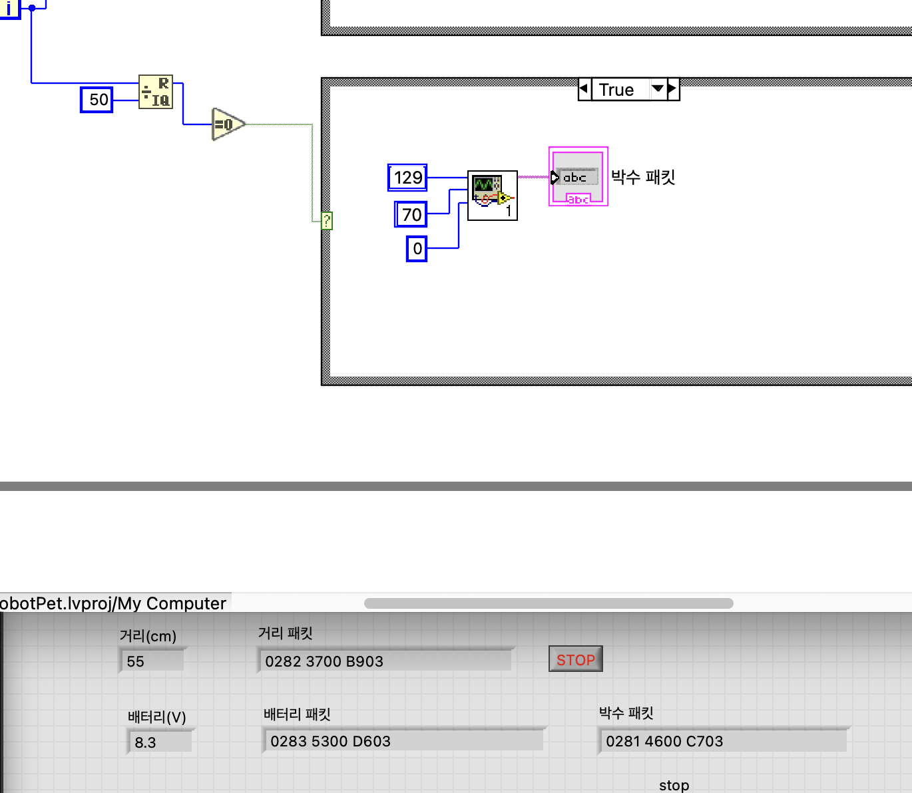
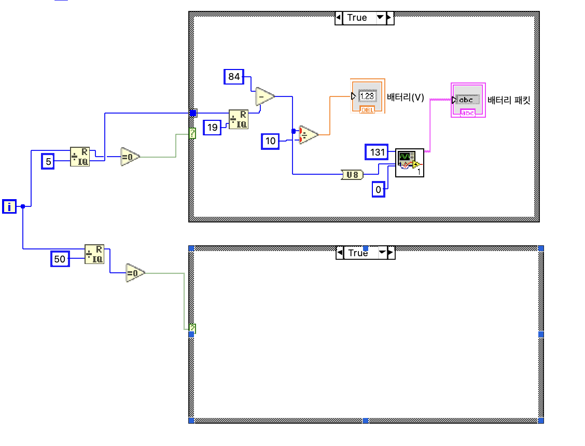
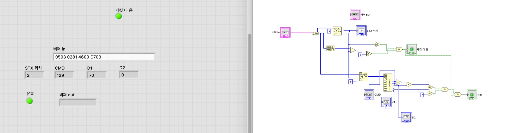
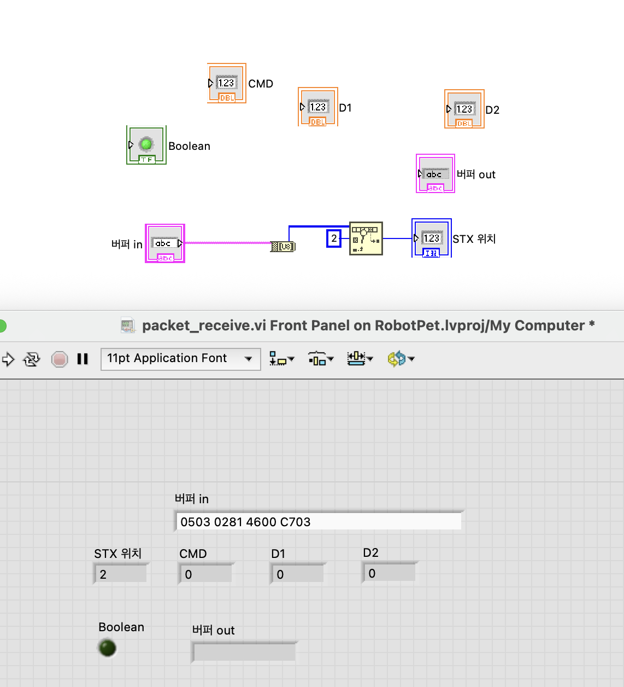
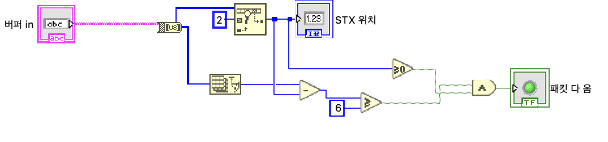
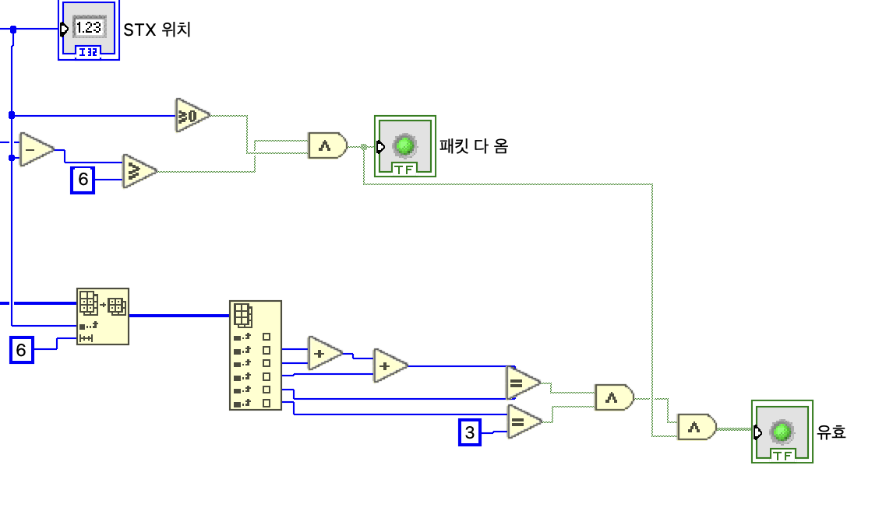

# robot-pet

디지털시스템설계 팀 프로젝트: 박수에 반응하는 펫로봇 (아두이노 Uno + LabVIEW 블루투스 연동)

| 폴더 | 내용 |
|---|---|
| `firmware/` | 아두이노 스케치 (`fake_arduino/`: LabVIEW 통신 시험용) |
| `labview/` | LabVIEW `.vi` 파일과 구현 가이드 |
| `docs/` | 통신 규칙 표 등 문서 |

- 통신 규칙: [docs/protocol.md](docs/protocol.md) (변경 시 HW·SW 둘 다 합의)
- HW 담당은 최신 코드를 받아 업로드만 한다.

## 진행 상황 (LabVIEW)

`.vi` 파일은 GitHub에서 내용이 보이지 않아 단계별 스크린샷을 함께 남긴다. (`docs/images/`)

### 가짜 아두이노 — `labview/test/fake_arduino.vi` ✅ (2026-10-27)

부품 없이 LabVIEW를 시험하기 위해 아두이노가 보낼 패킷을 흉내 낸다. 200ms 루프.

| 패킷 | 주기 | 예시 |
|---|---|---|
| `0x82` 거리 | 200ms (100↔5cm 왕복) | `0282 3700 B903` = 55cm |
| `0x83` 배터리 | 1초 (8.4V→6.6V 반복) | `0283 5300 D603` = 8.3V |
| `0x81` 박수 | 10초 (소리 크기 70) | `0281 4600 C703` |

박수 패킷 Case 구조 (i mod 50 = 0)

### 패킷 생성 subVI — `labview/subvi/packet_build.vi` ✅

CMD·D1·D2를 받아 `[02][CMD][D1][D2][체크섬][03]` 6바이트 문자열을 만든다. VISA Write 연결은 블루투스 연결 후 진행.

### 패킷 수신 subVI — `labview/subvi/packet_receive.vi` 🚧 (진행 중)

블루투스로 들어온 데이터에서 진짜 패킷만 골라내고 깨진 데이터는 버린다.

| 단계 | 하는 일 | 상태 |
|---|---|---|
| ① STX 찾기 | 앞에 붙은 쓰레기 값을 건너뛰고 `02` 위치 찾기 | ✅ |
| ② 6바이트 도착 확인 | 반만 온 패킷은 기다림 | ✅ |
| ③ ETX·체크섬 검사 | 깨진 패킷 거르기 → CMD/D1/D2, 유효 출력 | ✅ |
| ④ 버퍼 out | 읽고 남은 바이트를 다음 검사로 넘김 | ⬜ |

| 테스트 입력 | 유효 | 결과 |
|---|---|---|
| `0503 0281 4600 C703` | True | CMD 129 / D1 70 / D2 0 |
| `0503 0281 4600 C803` (체크섬 틀림) | False | |
| `0503 0281 4600 C704` (ETX 틀림) | False | |
| `0503 0281 46` (덜 옴) | False | |

단계별 블록 다이어그램

① STX 찾기

② 6바이트 도착 확인

③ ETX·체크섬 검사

