# 1단계 · 통신 뼈대 (SW)

> 노션 체크리스트 "1단계 · 전원부 + 부품 단독 테스트 / 통신 뼈대" 중 SW 담당 항목
> 기간: 2026-10-26 ~ 2026-11-10 · 상태: **SW 항목 전부 완료 ✅** / 통합 점검 ① ⏸ (HW와 함께 진행 예정)

`.vi` 파일은 GitHub에서 내용이 보이지 않아 단계별 스크린샷을 함께 남긴다. 사진은 [`images/`](images/)에 있다.

| # | 노션 항목 | 파일 | 상태 |
|---|---|---|---|
| 1 | [가짜 아두이노](#1-가짜-아두이노) | `labview/test/fake_arduino.vi` | ✅ 10/27 |
| 2 | [패킷 송신 subVI](#2-패킷-송신-subvi) | `labview/subvi/packet_build.vi` + `main.vi` (VISA Write) | ✅ 10/26 · 11/10 |
| 3 | [패킷 수신 subVI](#3-패킷-수신-subvi) | `labview/subvi/packet_receive.vi` | ✅ 10/27 ~ 11/10 |
| 4 | [상태머신 뼈대](#4-상태머신-뼈대) | `labview/main.vi` | ✅ 11/10 |
| 5 | [가짜 아두이노로 박수 → 트리거감지](#5-박수-수신--대기에서-트리거감지로-전환) | `labview/main.vi` | ✅ 11/10 |
| + | [VISA 수신·송신 연결](#-visa-수신송신-연결) | `labview/main.vi` | ✅ 11/10 |
| 🔗 | [통합 점검 ①](#-통합-점검-) | — | ⏸ |

---

## 1. 가짜 아두이노

부품 없이 LabVIEW를 시험하기 위해 아두이노가 보낼 패킷을 흉내 낸다. 200ms 루프.

| 패킷 | 주기 | 예시 |
|---|---|---|
| `0x82` 거리 | 200ms (100↔5cm 왕복) | `0282 3700 B903` = 55cm |
| `0x83` 배터리 | 1초 (8.4V→6.6V 반복) | `0283 5300 D603` = 8.3V |
| `0x81` 박수 | 10초 (소리 크기 70) | `0281 4600 C703` |

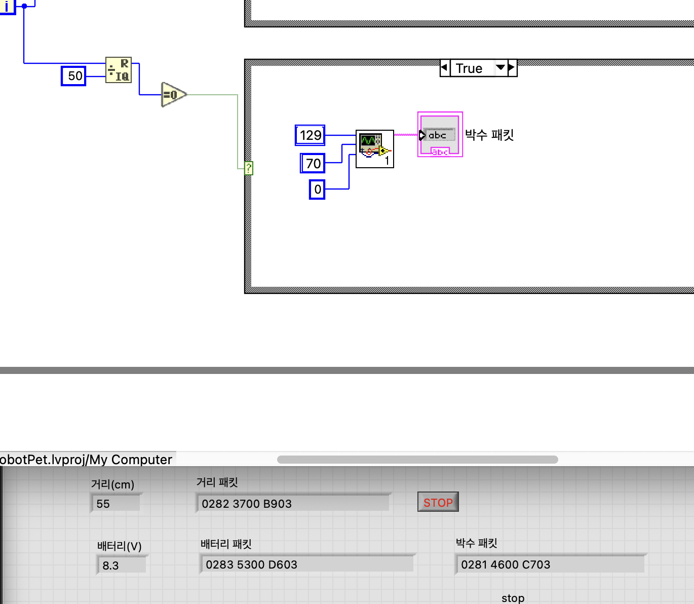

<details><summary>박수 패킷 Case 구조 (i mod 50 = 0)</summary>

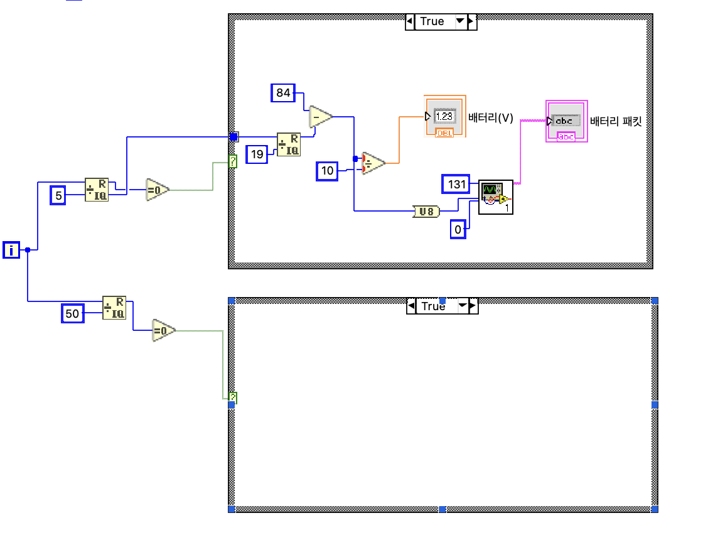
</details>

## 2. 패킷 송신 subVI

`packet_build.vi`: CMD·D1·D2 → `[02][CMD][D1][D2][체크섬][03]` 6바이트 문자열.

| 입력 | 출력 |
|---|---|
| CMD 2, D1 0, D2 90 (서보 0번 90도) | `0202 005A 5C03` |

VISA Write 연결은 `main.vi`에서 했다 → [VISA 수신·송신 연결](#-visa-수신송신-연결) (위쪽 채널·각도 → packet_build → 서보 보내기 → Write)

## 3. 패킷 수신 subVI

블루투스로 들어온 데이터에서 **진짜 패킷만 골라내고 깨진 데이터는 버리는 검문소.**

| 단계 | 하는 일 | 상태 |
|---|---|---|
| ① STX 찾기 | 앞에 붙은 쓰레기 값을 건너뛰고 `02` 위치 찾기 | ✅ 10/27 |
| ② 6바이트 도착 확인 | 반만 온 패킷은 기다림 | ✅ 10/27 |
| ③ ETX·체크섬 검사 | 깨진 패킷 거르기 → CMD/D1/D2, 유효 출력 | ✅ 10/28 |
| ④ 버퍼 out | 읽고 남은 바이트를 다음 검사로 넘김 (Select 3개로 버릴 개수 결정) | ✅ 11/02 |
| ⑤ 커넥터 패인 | 입력 버퍼 in / 출력 버퍼 out·유효·CMD·D1·D2 | ✅ 11/10 |

**버릴 바이트 수 (버퍼 out)**

| 경우 | 버릴 개수 |
|---|---|
| STX 없음 | 전부 |
| STX는 있는데 덜 옴 | STX 위치만큼 (기다림) |
| 다 왔고 유효 | STX 위치 + 6 |
| 다 왔는데 유효 아님 | STX 위치 + 1 (가짜 02만 버림) |

**테스트**

| 버퍼 in | 유효 | 버퍼 out | 의미 |
|---|---|---|---|
| `0503 0281 4600 C703` | True (129/70/0) | (빈 값) | 다 읽음 |
| `0503 0281 4600 C703 0282` | True | `0282` | 다음 패킷 앞부분 남김 |
| `0503 0281 46` | False | `0281 46` | 덜 와서 보관 |
| `0503` | False | (빈 값) | STX 없음 |
| `0503 0281 4600 C803` | False | `8146 00C8 03` | 체크섬 틀림 → 02 하나만 버림 |
| `0503 0281 4600 C704` | False | | ETX 틀림 |

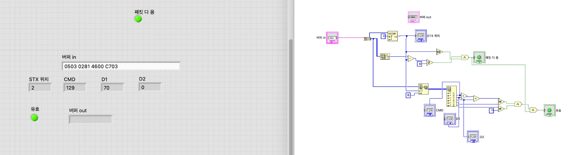

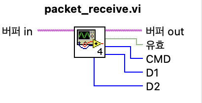

<details><summary>단계별 블록 다이어그램</summary>

① STX 찾기
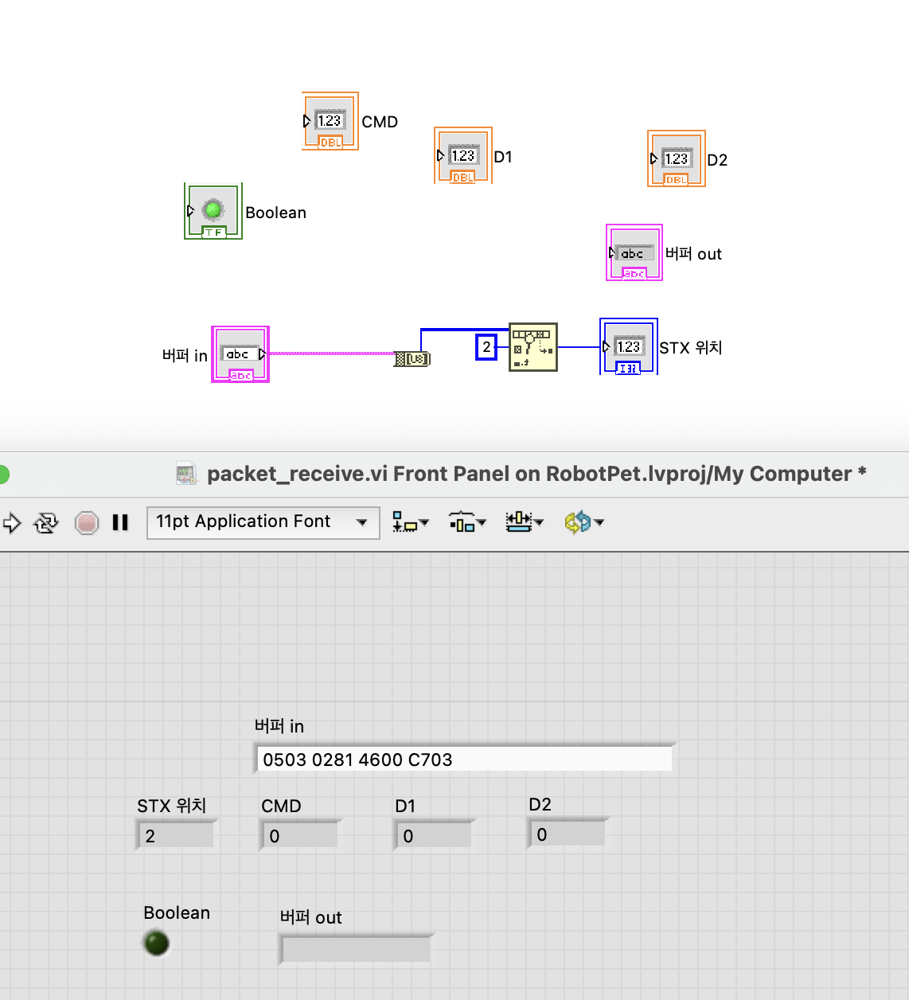

② 6바이트 도착 확인
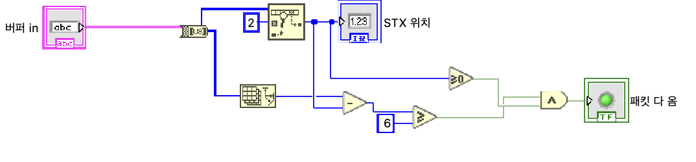

③ ETX·체크섬 검사
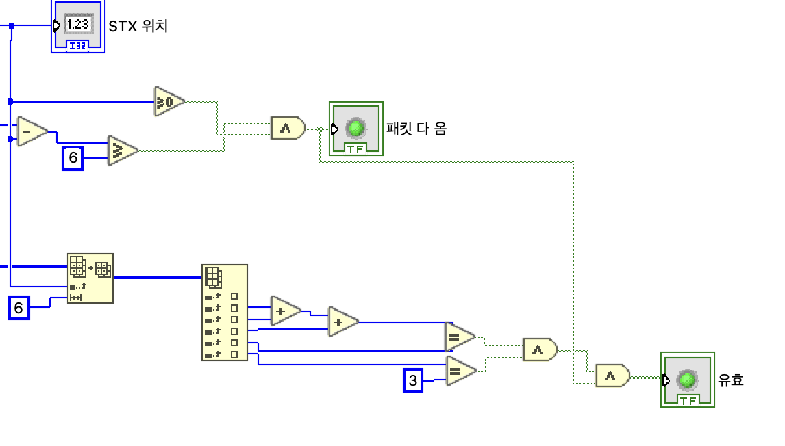
</details>

## 4. 상태머신 뼈대

While + Case + 시프트 레지스터. 상태 6개를 U8 Enum으로 만들고 번호를 통신 규칙과 같게 맞췄다.

| 번호 | 0 | 1 | 2 | 3 | 4 | 5 |
|---|---|---|---|---|---|---|
| 상태 | 대기 | 트리거감지 | 반응 | 탐색이동 | 회피 | 복귀 |

- 시작 상태: 대기 / 루프 100ms / 각 Case는 지금은 자기 상태를 유지
- 실행 결과: 현재 상태 = 대기

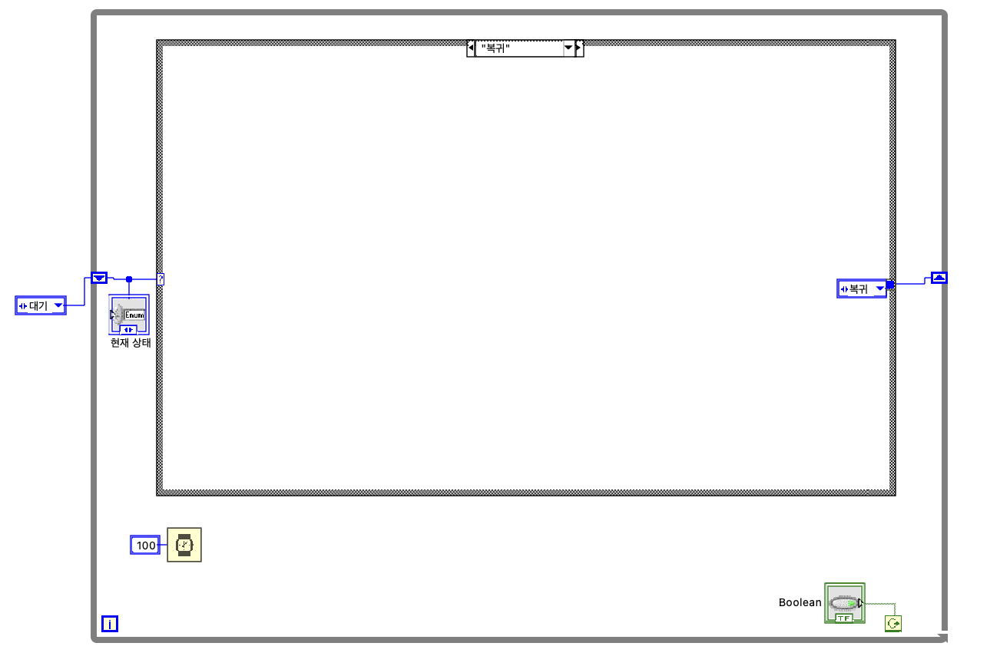

## 5. 박수 수신 → 대기에서 트리거감지로 전환

```
[박수 보내기 버튼] → 가짜 박수 패킷(129/70/0) → 버퍼 → packet_receive → 유효 AND CMD=129 → 트리거감지
```

- 버퍼는 두 번째 시프트 레지스터로 다음 바퀴에 넘긴다 (버퍼 out)
- 대기 Case 안: Select(참이면 트리거감지, 아니면 대기)
- 결과: 박수 보내기 클릭 → 현재 상태 = 트리거감지 ✅
- 박수 보내기 버튼은 **시험용 가짜**. 실제로는 아두이노가 박수를 감지해 0x81을 보내고 VISA Read로 들어온다.

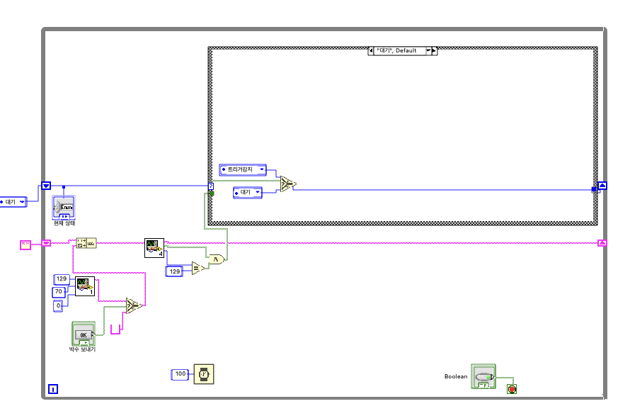

## + VISA 수신·송신 연결

`main.vi`에 실제 아두이노와 통신하는 부분을 붙였다.

| | 구성 |
|---|---|
| 포트 열기 (루프 밖) | Configure Port: COM 포트, **9600**, termination char **F** |
| 받기 (루프 안) | Bytes at Port → Read → 버퍼에 이어 붙임 → packet_receive |
| 보내기 (루프 안) | 채널·각도 → packet_build(CMD 2) → 서보 보내기 버튼 → Write |
| 닫기 (루프 밖) | Close → Simple Error Handler |

| 시험 (아두이노 없이) | 결과 |
|---|---|
| 채널 0, 각도 90 | 서보 패킷 `0202 005A 5C03` ✅ |
| 각도 180 | `0202 00B4 B603` ✅ |
| 박수 보내기 | 트리거감지 ✅ |

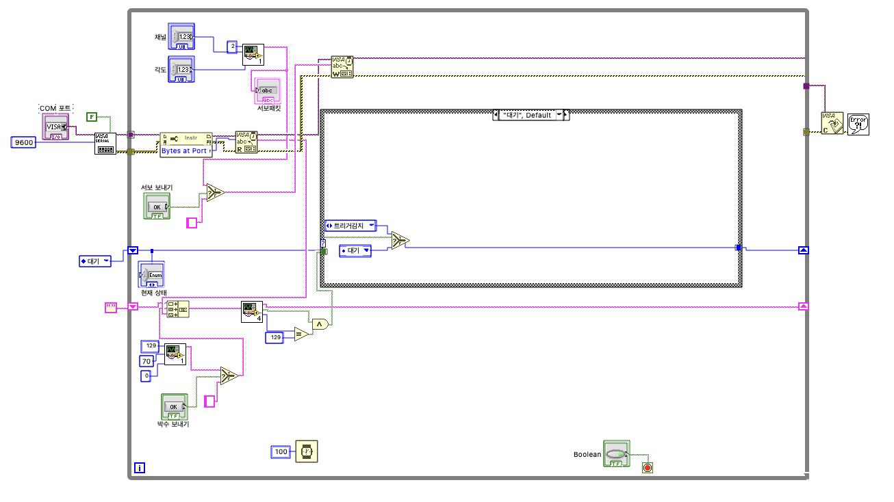

<details><summary>수신만 연결했을 때 (송신 추가 전)</summary>

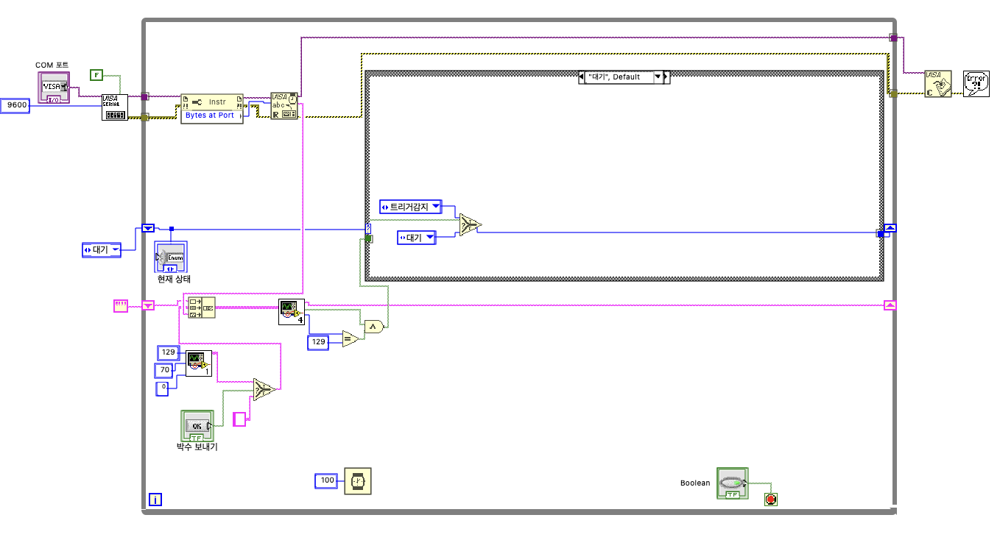
</details>

> 이 Mac에는 **NI-VISA가 아직 설치되지 않아** 실행 시 에러 -1073807202가 뜬다 (Continue로 넘어가면 시험 가능). 실제 연결 전에 설치 필요.

---

## 🔗 통합 점검 ①

HW(소연)와 함께 진행. 아래가 준비되면 한다.

| 항목 | LabVIEW | 펌웨어 | HW |
|---|---|---|---|
| 실제 블루투스로 박수 → 0x81 → LabVIEW 상태 전환 | ✅ | 2단계 receivePacket 등 | 마이크, HC-05 |
| LabVIEW에서 0x02 → 서보가 지정 각도로 | ✅ | 2단계 handleCommand 등 | PCA9685 + 서보 |

### 실제 연결 방법

**A. USB로 먼저 확인**
1. 아두이노를 USB로 연결 (Arduino IDE 시리얼 모니터는 닫기)
2. `main.vi` 프런트 패널 **COM 포트 ▼** → `usbmodem`이 들어간 포트 선택
3. ▶ 실행 → 1~2초 대기 (포트를 열면 아두이노가 재시작)
4. 박수 → 현재 상태 = 트리거감지
5. Boolean으로 멈추기 (멈춰야 포트가 닫힘)

**B. 블루투스(HC-05)**
1. HC-05 전원 → Mac 설정 ▸ Bluetooth에서 페어링 (PIN `1234` 또는 `0000`)
2. COM 포트 ▼에서 `HC-05`가 들어간 포트 선택
3. A의 3~5와 같음

### 주의할 것

| 상황 | 주의 |
|---|---|
| NI-VISA | 설치 안 하면 에러 -1073807202. ni.com에서 macOS용 설치 (안 되면 학교 Windows PC) |
| 속도 | LabVIEW 9600 = 펌웨어 `Serial.begin(9600)` = HC-05 기본값 |
| 종료 문자 | termination char는 **F** 유지 (T면 `0A`=10에서 읽기가 끊김) |
| 시리얼 모니터 | 켜 두면 포트 충돌 |
| 업로드할 때 | LabVIEW 먼저 멈추기. HC-05가 D0·D1이면 업로드 동안 빼기 |
| 포트 선택 | 실행 **전에** 선택. 에러 나면 멈추고 다시 선택 |
| 트리거감지 이후 | 아직 다음 상태 전환이 없어서 머무름 → 다시 시험하려면 재실행 |
| 박수가 안 잡힘 | 펌웨어 박수 임계값 문제 (HW 측정값으로 조정) |
| 박수 보내기 버튼 | 시험용. 실제 시험·시연 때는 누르지 않기 (나중에 제거) |
| 각도 | 0~180만. 채널은 PCA9685에 꽂은 번호 확인 |
| Mac + HC-05 | macOS에서 HC-05 시리얼 포트가 안 생길 수 있음 → USB 먼저 / Windows PC |
