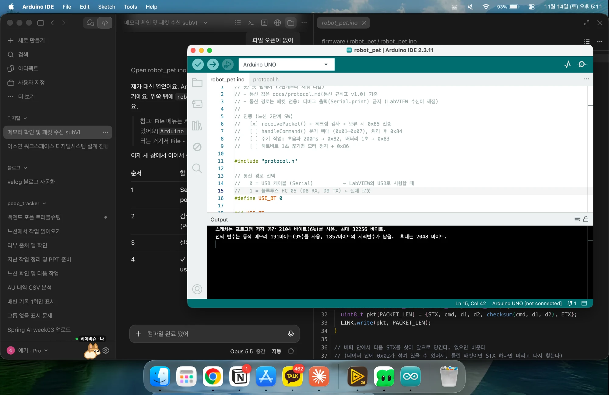
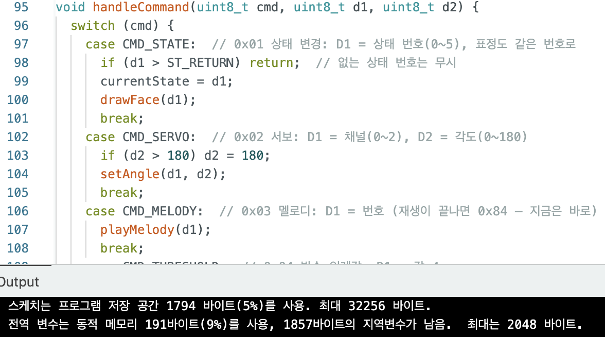

# 2단계 · 주행 + 초음파 / 펌웨어 프로토콜 (SW)

> 노션 체크리스트 "2단계 · 주행 + 초음파 / 펌웨어 프로토콜" 중 SW 담당 항목
> 상태: **진행 중** 🚧 · 진행하면서 항목별 설명과 사진을 채운다 (사진은 [`images/`](images/))

| # | 노션 항목 | 파일 | 상태 |
|---|---|---|---|
| 1 | [펌웨어 `receivePacket()` + 체크섬 검사 + 오류 시 0x85 전송](#1-receivepacket--체크섬-검사--오류-시-0x85) | `firmware/robot_pet/` | ✅ 11/14 |
| 2 | [`handleCommand()` 분기 뼈대 (0x01~0x07), 처리 후 0x84 완료 알림](#2-handlecommand-분기-뼈대) | `firmware/robot_pet/` | ✅ 11/14 |
| 3 | [주기 작업: 초음파 200ms → 0x82, 배터리 1초 → 0x83](#3-주기-작업) | `firmware/robot_pet/` | ✅ 11/14 |
| 4 | [하트비트(0x07) 수신 시간 기록, 1초 넘게 끊기면 모터 정지 + 0x86](#4-하트비트-감시) | `firmware/robot_pet/` | ✅ 11/14 |
| 5 | [LabVIEW: 하트비트 주기 전송 루프 추가](#5-labview-하트비트-전송) | `labview/main.vi` | ⬜ |
| 🔗 | [통합 점검 ②](#-통합-점검-) | — | ⬜ |

---

## 1. receivePacket() + 체크섬 검사 + 오류 시 0x85

`firmware/robot_pet/robot_pet.ino` — LabVIEW `packet_receive.vi`와 같은 검문소를 아두이노 쪽에 만들었다.

| 순서 | 하는 일 | 틀리면 |
|---|---|---|
| 1 | STX(`02`) 전의 쓰레기 값 버리기 | |
| 2 | 6바이트가 다 올 때까지 기다리기 (블로킹 없음) | |
| 3 | 끝이 ETX(`03`)인지 | `0x85` 원인 2 → `02 85 02 00 87 03` |
| 4 | 체크섬 | `0x85` 원인 1 → `02 85 01 00 86 03` |
| 5 | 통과하면 CMD·D1·D2 꺼냄 → 지금은 D13 LED 토글 (다음 항목 handleCommand 자리) | |

- 틀린 패킷이면 STX 하나만 버리고 버퍼 안에서 다음 `02`를 다시 찾는다 (데이터에 `02`가 섞일 수 있음)
- 통신 경로 `#define USE_BT`: **0 = USB(Serial)** 시험용 / **1 = HC-05(AltSoftSerial D8 RX, D9 TX)** 실제 로봇
- 속도 9600 (LabVIEW Configure Port, HC-05와 같게)
- 모르는 CMD(원인 3)는 2번 항목 handleCommand()에서 처리

**PC 시험 (가짜 시리얼로 코드만 실행)**

| 들어온 바이트 | 결과 |
|---|---|
| `02 02 00 5A 5C 03` | 정상 CMD 2 / 0 / 90 ✅ |
| `05 03` + 정상 패킷 | 쓰레기 건너뛰고 정상 ✅ |
| 체크섬 틀림 (`5D`) | `02 85 01 00 86 03` ✅ |
| ETX 틀림 (`04`) | `02 85 02 00 87 03` ✅ |
| 가짜 `02` + 정상 패킷 | 0x85 후 진짜 패킷 찾음 ✅ |
| 패킷 2개 연속 | 둘 다 받음 ✅ |
| 반만 오고 나머지 나중에 | 다 온 뒤 정상 ✅ |

**Arduino IDE 컴파일 (Uno)**: 저장 공간 2104바이트(6%), 메모리 191바이트(9%), 오류 없음 ✅



> 실제 보드 업로드·LabVIEW 통신 확인은 아직 (보드 + NI-VISA 필요). `USE_BT 1`로 쓸 때는 라이브러리 매니저에서 AltSoftSerial 설치.

## 2. handleCommand() 분기 뼈대

| CMD | 의미 |
|---|---|
| `0x01` | 상태 변경 |
| `0x02` | 서보 각도 |
| `0x03` | 멜로디 |
| `0x04` | 박수 임계값 |
| `0x05` | 표정 |
| `0x06` | 모터 |
| `0x07` | 하트비트 (0x84 안 보냄) |

`receivePacket()`이 통과시킨 패킷을 CMD별로 나눠 처리하고, 끝나면 **0x84(D1 = 완료한 CMD)** 를 보낸다.

| CMD | 받으면 | 답장 |
|---|---|---|
| 0x01 상태 변경 | 현재 상태 저장 + `drawFace()` (6 이상은 무시) | 0x84 |
| 0x02 서보 | `setAngle(채널, 각도)` (180 넘으면 180) | 0x84 |
| 0x03 멜로디 | `playMelody(번호)` | 0x84 |
| 0x04 박수 임계값 | 임계값 = D1 × 4 (50 → 200) | 0x84 |
| 0x05 표정 | `drawFace(번호)` | 0x84 |
| 0x06 모터 | D1 0 정지 / 1 전진 / 2 후진 / 3 좌 / 4 우, D2 속도 | 0x84 |
| 0x07 하트비트 | 받은 시각 기록 | 없음 |
| 그 밖 | — | 0x85 원인 3 |

- 부품 함수(`setAngle`, `forward` …)는 **빈 자리**. HW 코드(`firmware/tests/`)를 가져와 채운다 → 지금은 0x84만 보내고 부품은 안 움직임
- 역할: **SW = 뼈대(패킷 받기·명령 분기)**, **HW = 부품 함수** → 최종적으로 `robot_pet.ino` 하나로 합쳐 아두이노에 올린다

**PC 시험 (10개 통과)**

| 보낸 패킷 | 답장 |
|---|---|
| 0x01 상태 1 | `02 84 01 00 85 03` ✅ |
| 0x02 서보 0번 90도 | `02 84 02 00 86 03` ✅ |
| 0x03 멜로디 1 | `02 84 03 00 87 03` ✅ |
| 0x04 임계값 50 | `02 84 04 00 88 03` ✅ (임계값 200) |
| 0x05 표정 2 | `02 84 05 00 89 03` ✅ |
| 0x06 전진 180 | `02 84 06 00 8A 03` ✅ |
| 0x07 하트비트 | (없음) ✅ |
| 0x08 모르는 CMD | `02 85 03 00 88 03` ✅ |
| 0x01 상태 9 | (무시) ✅ |
| 체크섬 틀림 | `02 85 01 00 86 03` ✅ |

Arduino IDE 컴파일 성공 ✅ (Uno 1794바이트 5% / 191바이트 9%)



## 3. 주기 작업

| 패킷 | 주기 | D1 |
|---|---|---|
| `0x82` 거리 | 200ms | cm (최대 255) |
| `0x83` 배터리 | 1초 | 전압 × 10 |

LabVIEW가 묻지 않아도 아두이노가 정해진 시간마다 센서 값을 보낸다. **HW 측정 코드(`firmware/tests/ultrasonic_test`, `battery_test`)를 가져와 처음으로 합쳤다.**

| | 측정 | 변환 |
|---|---|---|
| 거리 | TRIG D10 / ECHO D11, `pulseIn` 30ms 제한 | t × 0.034 ÷ 2 반올림, 메아리 없음·255 초과 → **255** |
| 배터리 | A1 (10kΩ×2 분압) | raw × 5 ÷ 1023 × 2 × 10 반올림 (8.36V → 84) |

```
loop()
 ├ receivePacket → handleCommand   (LabVIEW 명령)
 └ periodicTasks(millis)
     ├ 200ms 지났으면 → 0x82
     └ 1초 지났으면   → 0x83
```
- `delay()` 대신 `millis()`로 시간을 재서 기다리는 동안에도 명령을 받는다

**PC 시험 (11개 통과)**

| 상황 | 보낸 패킷 |
|---|---|
| 200ms, 20cm | `02 82 14 00 96 03` ✅ |
| 300ms | (없음) ✅ |
| 1000ms, 8.36V | 거리 + `02 83 54 00 D7 03` ✅ |
| 메아리 없음 | `02 82 FF 00 81 03` ✅ |
| 340cm | 255로 제한 ✅ |
| 10cm | `02 82 0A 00 8C 03` ✅ |
| 6.6V | `02 83 42 00 C5 03` ✅ |
| 중간에 0x01 | 0x84 답장 ✅ |

Arduino IDE 컴파일 성공 ✅

> - 메아리 없음 = 255는 규칙표 "최대 255" 안이지만 HW와 확인 필요
> - LabVIEW 화면 표시는 아직 없음 (통합 점검 ② 전에 표시기 추가)
> - 10cm 즉시 정지·6.6V 저전압 정지는 뒤 항목

## 4. 하트비트 감시

LabVIEW가 200~300ms마다 보내는 "살아 있음" 신호(0x07)가 **1초 넘게 안 오면** 블루투스가 끊긴 걸로 보고 로봇이 스스로 멈춘다.

| 상황 | 아두이노 동작 |
|---|---|
| 0x07이 계속 옴 | 받은 시각만 기록 (답장 없음) |
| 마지막 0x07 후 1초 넘음 | `stopMotor()` + `02 86 02 00 88 03` (한 번만) |
| 안전 정지 중 0x06(모터) | 무시 |
| 안전 정지 중 서보·표정 등 | 그대로 됨 |
| 0x01 대기(0) / 복귀(5) | 안전 정지 풀림 |
| 0x07을 한 번도 안 받음 | 판단 안 함 (LabVIEW가 아직 안 켜짐) |

**PC 시험 (12개 통과)**: 받기 전 3초·계속 받는 중 → 0x86 없음 / 1.05초 끊김 → 0x86 원인 2 / 한 번만 / 정지 중 전진 무시·서보는 됨 / 하트비트 다시 와도 모터 무시 / 트리거감지(1)로는 안 풀림 / 대기(0)·복귀(5)로 풀림 / 다시 끊기면 또 0x86 ✅

Arduino IDE 컴파일 성공 ✅

> LabVIEW가 0x07을 보내야 이 안전장치가 작동한다 → 5번 항목

## 5. LabVIEW 하트비트 전송

- `main.vi`에서 0x07을 200~300ms마다 Write

_(진행 후 작성)_

---

## 🔗 통합 점검 ②

- [ ] LabVIEW 명령(0x06)으로 전진·정지
- [ ] LabVIEW 화면에 거리·배터리 값이 실시간 표시
- [ ] 노트북 블루투스 끄면 1초 안에 로봇 정지

> HW(소연) 2단계: 섀시 조립, L298N 배선, 전진·정지 테스트, HC-SR04 거리 측정, `forward / backward / turn / stopMotor` 함수
