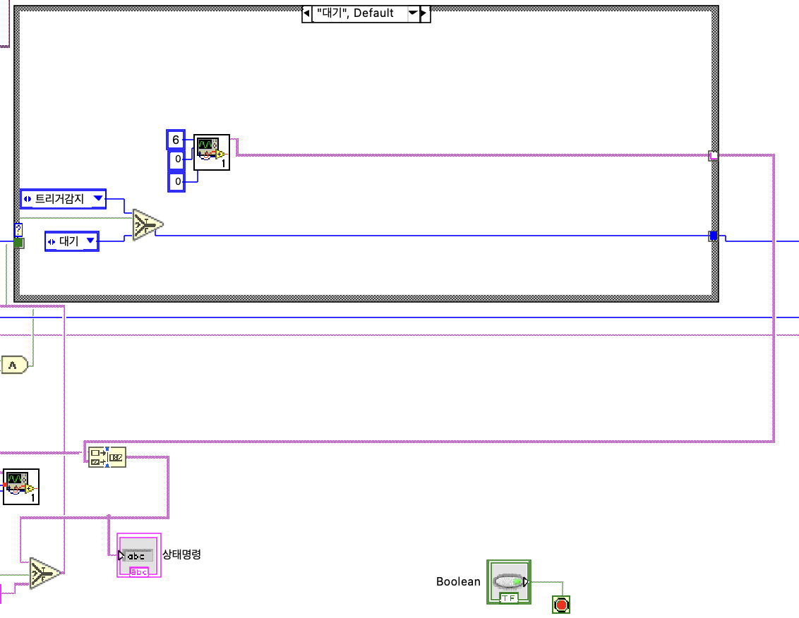
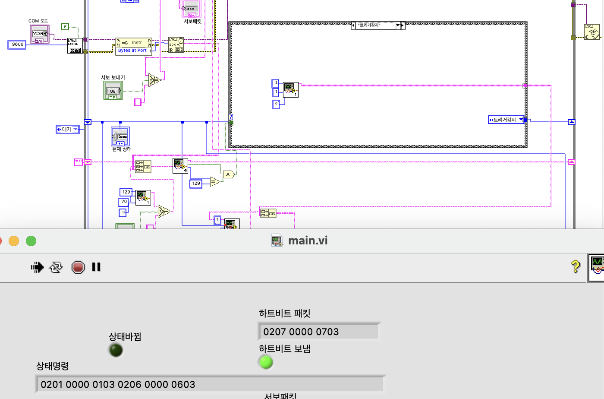

# 4단계 · LabVIEW 상태머신 + GUI 완성 (SW)

> 노션 체크리스트 "4단계 · LabVIEW 상태머신 + GUI 완성" SW 항목
> 상태: **진행 중** 🚧 · 사진은 [`images/`](images/)

| # | 노션 항목 | 파일 | 상태 |
|---|---|---|---|
| 1 | [상태별 동작 연결: 각 Case에서 표정·멜로디·서보·모터 명령 전송](#1-상태별-동작-연결) | `labview/main.vi` | ✅ 11/15 |
| 2 | [상태 전이 조건: 박수 → 트리거감지, 동작 완료(0x84) → 다음 상태, 거리 20cm 이하 → 회피, 30초 무반응 → 복귀](#2-상태-전이-조건) | `labview/main.vi` | ⬜ |
| 3 | [탐색 이동 패턴: 전진 1.5초 → 정지 1초 반복](#3-탐색-이동-패턴) | `labview/main.vi` | ⬜ |
| 4 | [모든 상태에서 0x86(안전 정지) 또는 비상 정지 버튼 → 복귀](#4-안전-정지비상-정지--복귀) | `labview/main.vi` | ⬜ |
| 5 | [GUI: 현재 상태 LED, 임계값 슬라이더(0x04), 거리·배터리 숫자, 로그 차트, 비상 정지 버튼](#5-gui) | `labview/main.vi` | ⬜ |

---

## 1. 상태별 동작 연결

상태가 **바뀌는 순간 한 번만** 아두이노에 명령을 보낸다 (100ms마다 보내면 멜로디가 계속 처음부터 다시 시작되므로).

**Part A — 상태가 바뀔 때 0x01**
- 세 번째 시프트 레지스터에 **이전 상태** 저장 (처음 값 대기)
- `상태 바뀜` = (현재 상태 ≠ 이전 상태) OR (i = 0, 첫 바퀴)
- 바뀌었을 때만 `packet_build(1, 현재 상태, 0)` → Write (서보·하트비트 패킷과 Concatenate)
- 0x01을 받으면 아두이노가 **같은 번호 표정**을 그리고, 대기·복귀면 **안전 정지도 풀림**

**Part B — 각 Case의 명령** (Case 출력 터널 → 0x01 패킷 뒤에 이어 붙임)

| 상태 | 명령 (CMD / D1 / D2) | 뜻 |
|---|---|---|
| 0 대기 | 6 / 0 / 0 | 정지 |
| 1 트리거감지 | 3 / 1 / 0 | 멜로디 1 (깸) |
| 2 반응 | 3 / 2 / 0 + 2 / 0 / 150 | 멜로디 2 (기쁨) + 서보 0번 150° |
| 3 탐색이동 | 6 / 1 / 180 | 전진 |
| 4 회피 | 6 / 2 / 180 | 후진 |
| 5 복귀 | 3 / 3 / 0 + 2 / 0 / 90 + 6 / 0 / 0 | 멜로디 3 (잘 자) + 서보 90° + 정지 |

**시험** (아두이노 없이, 바깥 처음 Enum을 바꿔 실행)

| 상태 | 상태명령 (Hex) |
|---|---|
| 대기 | `0201 0000 0103 0206 0000 0603` ✅ |
| 트리거감지 (박수 보내기) | `0201 0100 0203 0203 0100 0403` ✅ |
| 반응 | `0201 0200 0303 0203 0200 0503 0202 0096 9803` ✅ |
| 탐색이동 | `0201 0300 0403 0206 01B4 BB03` ✅ |
| 회피 | `0201 0400 0503 0206 02B4 BC03` ✅ |
| 복귀 | `0201 0500 0603 0203 0300 0603 0202 005A 5C03 0206 0000 0603` ✅ |

- `상태 바뀜` LED: 시작할 때·박수로 바뀔 때 한 번씩만 깜빡 ✅

> - 지금은 다음 상태로 넘어가는 조건이 없어서 탐색이동에 들어가면 계속 전진 → 2번 항목
> - 회피는 지금 후진만 (10주차 "후진 + 회전"은 시간 순서와 함께)

## 2. 상태 전이 조건

_(진행 후 작성)_

## 3. 탐색 이동 패턴

_(진행 후 작성)_

## 4. 안전 정지·비상 정지 → 복귀

_(진행 후 작성)_

## 5. GUI

_(진행 후 작성)_
